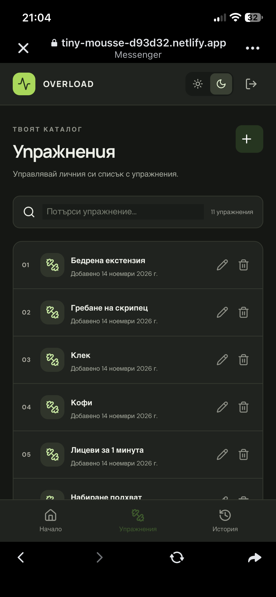

# Приложението е разработено с помощта на OpenAI Codex, генерираният код не следва оптимални практики за четимост, поддръжка, разделение на отговорностите и софтуерна архитектура.

# Progressive Overload — Workout Diary

Адаптивен дневник за силови тренировки с личен каталог от упражнения, запис на серии, предишно изпълнение, история и автоматично изчисляване на тренировъчния обем. Данните се съхраняват в Supabase и са изолирани чрез Row Level Security.

## 📸 Screenshots

<table>
  <tr>
    <td></td>
    <td></td>
  </tr>
    <td></td>
    <td></td>
  <tr>
  </tr>
  <tr>
    <td></td>
    <td></td>
  </tr>
  <tr>
    <td></td>
    <td></td>
  </tr>
</table>

## Стек

React, Vite, JavaScript, React Router DOM, Supabase Auth, Supabase PostgreSQL и CSS.

## Локално стартиране

1. Инсталирай Node.js 20 или по-нова версия.
2. Инсталирай пакетите: `npm install`.
3. Копирай `.env.example` в `.env` и попълни `VITE_SUPABASE_URL` и `VITE_SUPABASE_PUBLISHABLE_KEY` от Supabase Dashboard → Project Settings → API.
4. Изпълни SQL миграциите в Supabase Dashboard → SQL Editor → New query → Run, по ред: `202611140001_initial_schema.sql`, после `202611140002_allow_completed_workout_deletion.sql`.
5. Стартирай приложението: `npm run dev`.

За регистрация и вход използвай имейл и парола. Настрой имейл потвърждението и URL адресите за пренасочване в Supabase Authentication → URL Configuration. За локална разработка добави `http://localhost:5173/**` в Redirect URLs.

## Функционалности

- Регистрация, вход, изход и възстановяване на парола чрез Supabase Auth.
- Начално табло с активна тренировка, активност и последна тренировка.
- CRUD за лични упражнения; преименуването и изтриването запазват историческото име.
- Една активна тренировка на потребител; възстановява се след презареждане.
- Добавяне и редактиране на упражнения и серии с тежест и повторения.
- Справка с последното приключено изпълнение за упражнение.
- История и подробен преглед; обемът е сбор от тежест × повторения.
- Адаптивна навигация, мобилни числови полета и Netlify SPA redirect.

## Supabase и сигурност

Миграциите създават таблиците `exercises`, `workouts`, `workout_exercises` и `workout_sets`, ограничения, индекси, външни ключове и RLS политики. Втората миграция разрешава на потребителя да изтрива собствените си тренировки от историята. Изпълняват се ръчно в SQL Editor и в посочения ред; приложението не изпълнява миграции и не променя отдалечена база автоматично. Упражненията в тренировките пазят копие от името си. При изтриване от каталога `exercise_id` се занулява, а миналото име и сериите остават.

Във frontend се използва само Supabase project URL и publishable key. Никога не поставяй `service_role` или secret ключ във Vite променливи. Не добавяй `.env` в Git.

## Production и Netlify

Production build: `npm run build`; локален преглед: `npm run preview`. При Netlify свържи репозитория, задай build command `npm run build`, publish directory `dist` и същите две environment variables в Site configuration → Environment variables. `netlify.toml` съдържа SPA fallback за React Router. След deploy добави production URL в Supabase Authentication → URL Configuration и разрешените redirect URLs.

## Текущи ограничения

Supabase credentials и проектът в Supabase се предоставят от собственика. След добавянето им може да се използват автентикацията и базата; без тях приложението показва настройките за свързване. Потвърждение на имейл, SMTP и реални заявки към базата зависят от настройките на Supabase и не се симулират локално.
