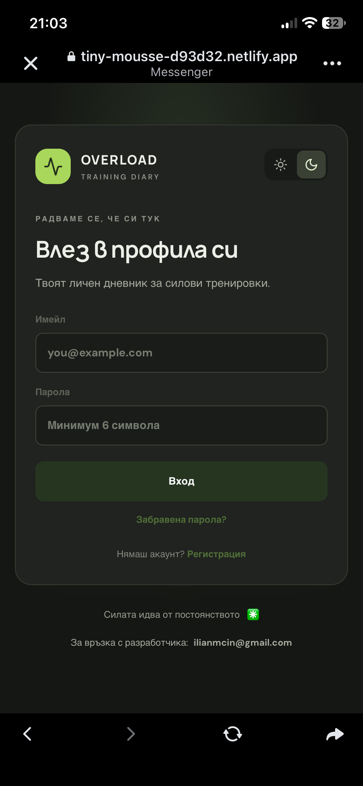
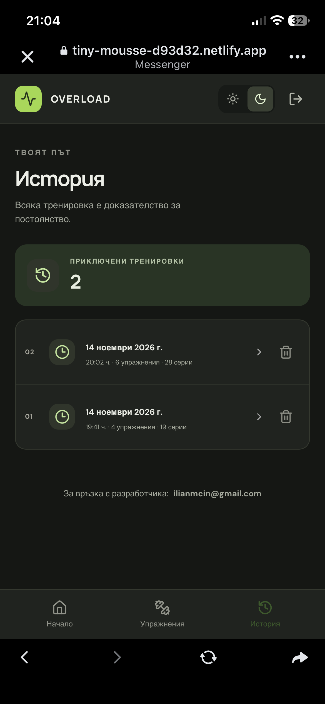
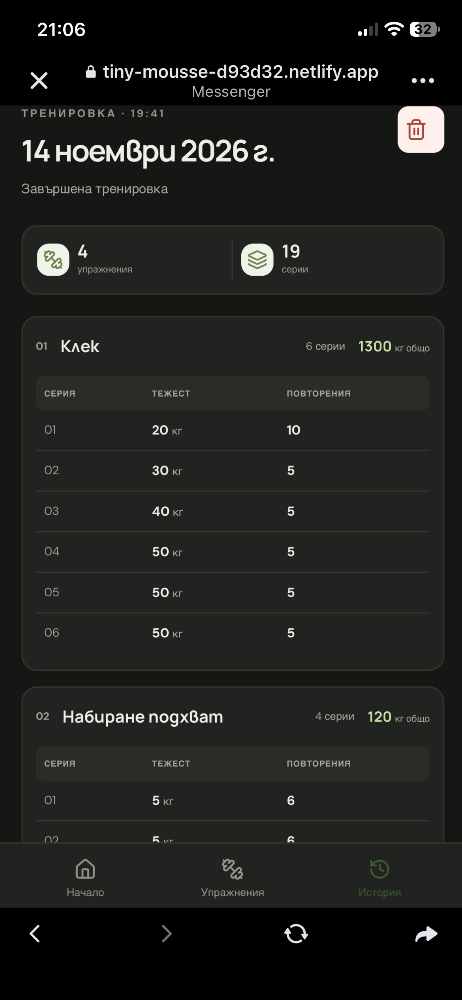

# Приложението е разработено с помощта на OpenAI Codex, генерираният код не следва оптимални практики за четимост, поддръжка, разделение на отговорностите и софтуерна архитектура.

# Progressive Overload — Workout Diary

Адаптивен дневник за силови тренировки, в който можеш да поддържаш собствен каталог с упражнения, да записваш серии, да следиш предишните си резултати и да преглеждаш историята на тренировките си. Приложението изчислява автоматично тренировъчния обем, а данните се съхраняват в Supabase.

## 📸 Screenshots

<table>
  <tr>
    <td></td>
    <td></td>
  </tr>
  <tr>
    <td></td>
    <td></td>
  </tr>
  <tr>
    <td></td>
    <td></td>
  </tr>
  <tr>
    <td></td>
    <td></td>
  </tr>
</table>

## Стек

React, Vite, JavaScript, React Router DOM, Supabase Auth, Supabase PostgreSQL и CSS.

## Локално стартиране

1. Инсталирай Node.js 20 или по-нова версия.
2. Инсталирай необходимите пакети с `npm install`.
3. Копирай `.env.example` в `.env` и попълни `VITE_SUPABASE_URL` и `VITE_SUPABASE_PUBLISHABLE_KEY` от Supabase Dashboard → Project Settings → API.
4. Изпълни SQL миграциите през Supabase Dashboard → SQL Editor → New query → Run, в следния ред:
   - `202611140001_initial_schema.sql`
   - `202611140002_allow_completed_workout_deletion.sql`
5. Стартирай приложението с `npm run dev`.

За регистрация и вход са необходими имейл и парола. Настрой потвърждението на имейл и адресите за пренасочване от Supabase Authentication → URL Configuration. За локална разработка добави `http://localhost:5173/**` в Redirect URLs.

## Функционалности

- Регистрация, вход, изход и възстановяване на парола.
- Начално табло с информация за активната и последната тренировка.
- Добавяне, редактиране и изтриване на упражнения.
- Запазване на историческите имена на упражненията при преименуване или изтриване.
- Една активна тренировка на потребител, която се запазва и след презареждане на страницата.
- Добавяне на упражнения и серии с индивидуална тежест и брой повторения.
- Справка за последното изпълнение на всяко упражнение.
- История на тренировките с подробна информация за всяка от тях.
- Автоматично изчисляване на тренировъчния обем (тежест × повторения).
- Адаптивен дизайн и навигация, съобразени с използването на телефон.

## Supabase и сигурност

Приложението използва четири основни таблици: `exercises`, `workouts`, `workout_exercises` и `workout_sets`. SQL миграциите създават необходимите таблици, връзки, индекси, ограничения и RLS политики.

Миграциите се изпълняват ръчно през Supabase SQL Editor в посочения по-горе ред. Приложението не ги изпълнява автоматично.

Всяка тренировка пази копие на името на използваното упражнение. Така дори ако упражнението бъде преименувано или изтрито от каталога, информацията за старите тренировки остава запазена.

В приложението се използват само Supabase Project URL и Publishable Key. Не поставяй `service_role` или secret ключове във frontend кода. Файлът `.env` не трябва да се качва в GitHub.

## Production и Netlify

За production build използвай `npm run build`, а за локален преглед на готовата версия – `npm run preview`.

При deploy в Netlify свържи GitHub репозитория и задай:
- Build command: `npm run build`
- Publish directory: `dist`

Добави същите две environment variables, които използваш и локално. Файлът `netlify.toml` съдържа необходимото пренасочване за React Router.

След публикуването добави адреса на приложението в Supabase Authentication → URL Configuration, за да работят регистрацията, входът и пренасочванията.

## Текущи ограничения

Приложението изисква собствен Supabase проект и съответните API настройки. Те се предоставят от собственика на инстанцията.

Работата с реална база данни и автентикацията зависят от правилната конфигурация на Supabase. Потвърждението на имейли и изпращането на писма за възстановяване на парола също зависят от настройките на услугата и използвания SMTP сървър.